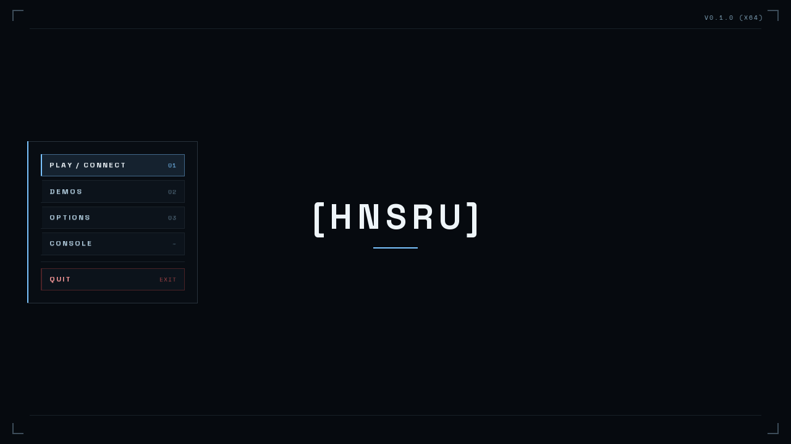
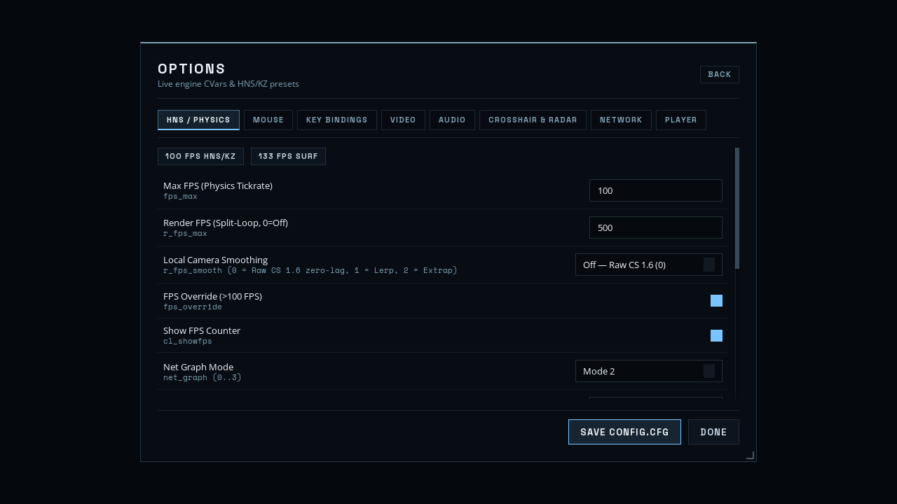
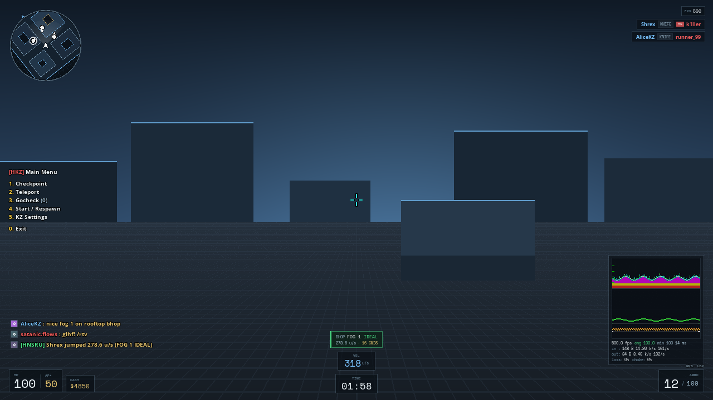
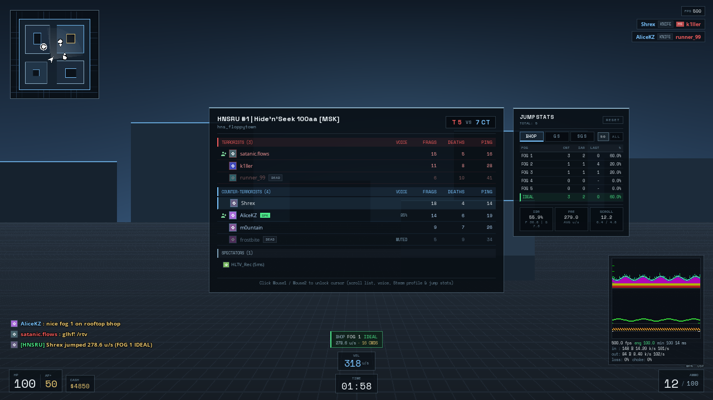
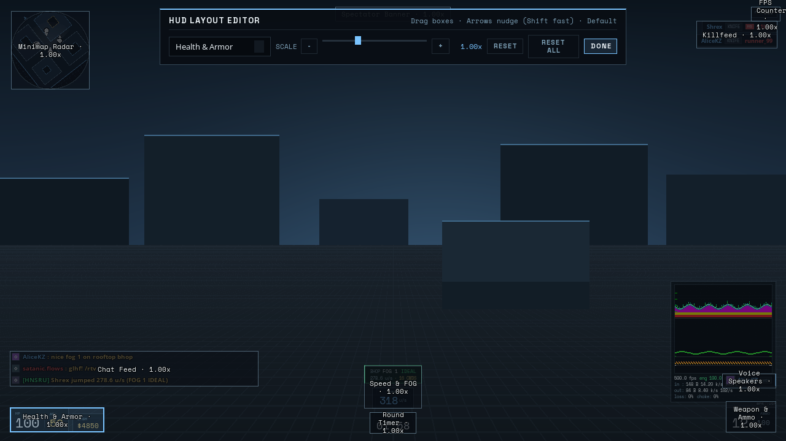
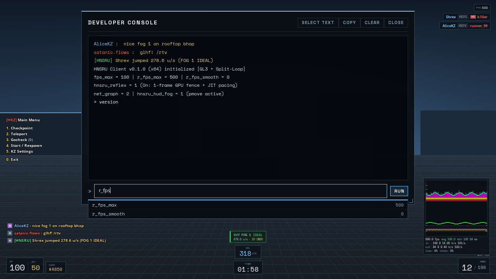
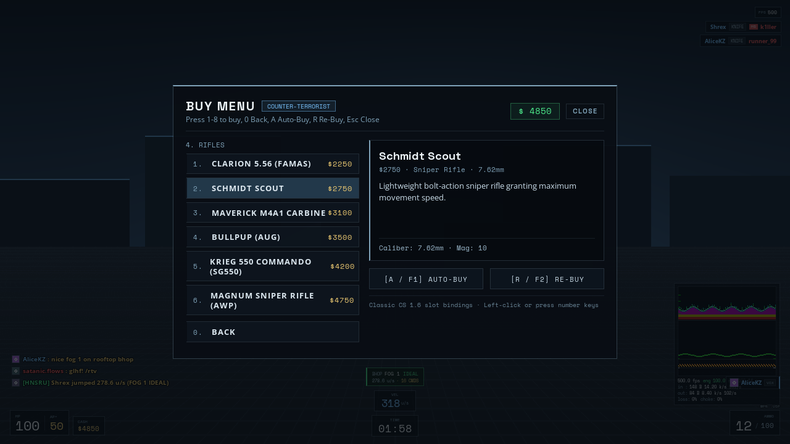
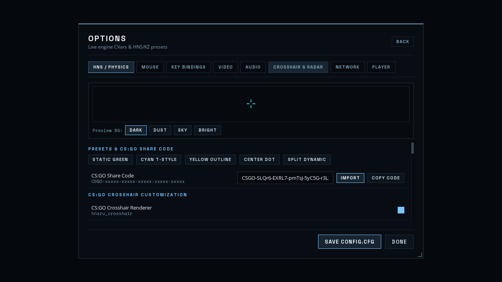
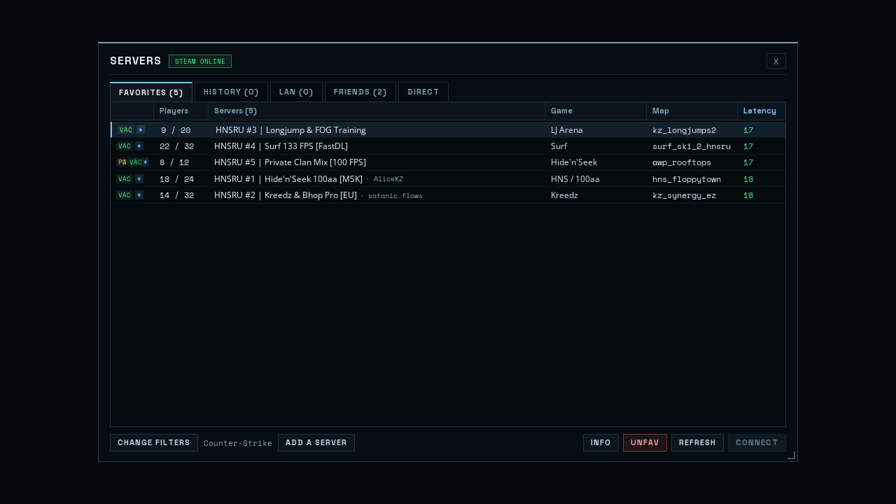

**English** | [Русский](ANNOUNCEMENT_RU.md)

# HNSRU Client v0.1.0 (x64) — The Modern CS 1.6 Client for HNS, KZ & Surf

**HNSRU Client** is a rebuilt 64-bit Counter-Strike 1.6 client crafted specifically for the **Hide'n'Seek, Kreedz (KZ), and Surf** community.

Everything runs from a single clean `hnsru.exe` (without legacy UI or browser bloat), connects directly to your running Steam client, delivers a modern **OpenGL 3.3** renderer, decouples **500+ visual FPS** from classic physics, and features a cohesive **Tactical Glass Visor** interface.

---

## Table of Contents

1. [Silky 500+ Visual FPS with Authentic 100/133 Physics (Split-Loop)](#1-silky-500-visual-fps-with-authentic-100133-physics-split-loop)
2. [Ultra-Low Input Lag: Reflex-Lite (`hnsru_reflex`)](#2-ultra-low-input-lag-reflex-lite-hnsru_reflex)
3. [Modern OpenGL 3.3 Renderer & Instant Video Changes](#3-modern-opengl-33-renderer--instant-video-changes)
4. [HNS / KZ / Surf Tools: FOG, ShowPre & Jump Stats](#4-hns--kz--surf-tools-fog-showpre--jump-stats)
5. [Tactical Glass Visor UI & Interactive HUD Editor](#5-tactical-glass-visor-ui--interactive-hud-editor)
6. [CS:GO-Style Crosshair & Live Map Radar](#6-csgo-style-crosshair--live-map-radar)
7. [Steam Server Browser, Avatars, Friends & Per-Player Mute](#7-steam-server-browser-avatars-friends--per-player-mute)
8. [Crisp 48 kHz Audio, Category Mixer & Fast Map Downloads](#8-crisp-48-khz-audio-category-mixer--fast-map-downloads)
9. [Demos (`.dem`), Safe HTML MOTD & Server Compatibility](#9-demos-dem-safe-html-motd--server-compatibility)
10. [Fair Play & Design Choices](#10-fair-play--design-choices)
11. [Quick Player Command Reference](#11-quick-player-command-reference)

---

## 1. Silky 500+ Visual FPS with Authentic 100/133 Physics (Split-Loop)

In classic CS 1.6, your screen refresh rate is locked to movement physics: if you raise `fps_max` to get smooth visuals on a 144/240/360 Hz monitor, jump gravity breaks, surf ramps start sticking, and servers kick you for high FPS.

**HNSRU Client** splits rendering from movement timing cleanly:

| Setting | What it means in plain English | Player recommendation |
| :--- | :--- | :--- |
| **`fps_max`** | **Your real physics & movement rate** (how often jumps, strafes, speed, and server updates are calculated). | **`100`** for HNS/KZ/Public, **`133`** for Surf. Servers see your exact physical rate (`100` or `133`). |
| **`fps_override`** | Allows setting physical `fps_max` above 100 (such as 133 for surf). | Enabled automatically when picking the `133 FPS Surf` preset. |
| **`r_fps_max`** | **Visual FPS** sent to your monitor — does **not** alter jump height, gravity, or movement speed! | **`500`** (default) or match your monitor (`240`, `360`, `500`). Set `0` to turn off split-loop. |
| **`r_fps_smooth`** | Camera pacing mode at high `r_fps_max`: • **`0` — Raw CS 1.6**: zero added delay, instant raw 1.6 mouse feel; • **`1` — Interpolated**: butter-smooth camera motion on 240–500 Hz screens; • **`2` — Extrapolated**: responsive predictive smoothing with no sluggish feel. | **`0`** for snappy HNS/KZ strafing, **`1`** for Surf or relaxing spectating. |
| **`cl_spec_interp`** | Smoothness of other players and spectator camera movement (in seconds). | **`0.05`** (default) — crisp, fluid air movement even at 500 FPS. |

### Redesigned `net_graph` with Real Physics FPS Readout
Classic `net_graph` often broke on modern drivers or overlapped HUD panels. We rebuilt it (`net_graph 1 / 2 / 3`) and added your **live physics FPS** right next to render FPS:
- White number on the left (`500.0 fps`) — your **visual frame rate**.
- Green **`eng 100.0`** and **`min 99.8`** — your actual **physics engine rate** and recent minimum. When `eng` stays green, physics are rock-solid at `100` Hz with zero jump stutter; if it turns yellow/red, something on your PC is dipping real physics ticks.

---

## 2. Ultra-Low Input Lag: Reflex-Lite (`hnsru_reflex`)

Even with high FPS or VSync on, many players notice a slightly floaty or rubbery mouse feel on modern GPUs. That comes from queued frames piling up ahead of what you actually see on screen, adding invisible lag between hand movement and crosshair motion.

**Reflex-Lite (`hnsru_reflex`)** cuts out that queue and lines up mouse sampling with each frame:

- **`hnsru_reflex 0` (Off)** — standard classic pacing without queue control.
- **`hnsru_reflex 1` (On — recommended default)** — the sweet spot of smooth frame times and snappy aim:
  1. **Prevents GPU frame buildup**: frames don't stack up behind the scenes waiting to display.
  2. **Just-in-time mouse read**: samples your mouse right before the new frame begins rendering instead of sitting idle after polling early.
  3. **With VSync (`gl_vsync 1`)**: locks smoothly to screen refresh without the traditional heavy VSync mouse lag.
- **`hnsru_reflex 2` (Boost)** — aggressive competitive mode for HNS/KZ and 240+ Hz displays, trimming timing margins down to squeeze out every last bit of mouse responsiveness.

> **How it feels in game:** strafes and flicks feel noticeably tighter, subtle mouse float at 100 physics FPS or under VSync disappears, and `r_fps_max` frame pacing stays steady.

---

## 3. Modern OpenGL 3.3 Renderer & Instant Video Changes

- **Updated GL3 Renderer (`r_gl3 1`)**: a modern 64-bit OpenGL 3.3 pipeline built for stable high FPS and crisp rendering across old and new maps.
- **Change resolution & window mode on the fly (`Options -> Video`)**: switch Fullscreen / Windowed, aspect ratios (`4:3`, `16:10`, `16:9`), and Stretch Aspect (stretched vs black bars) **without restarting or disconnecting from your server**.
- **True widescreen FOV (`gl_widescreen_yfov`)**: proper Hor+ field of view on `16:9` / `16:10` displays so edges aren't cropped (or toggle it off for classic `90°` framing).
- **One-click competitive presets**: `100 FPS HNS/KZ`, `133 FPS Surf`, and `HNSRU Optimal Network (100k / 101 / 0.01)`.

---

## 4. HNS / KZ / Surf Tools: FOG, ShowPre & Jump Stats

Instead of rough plugin overlays, we built accurate **movement telemetry directly into the client** following standard server rules:

- **Live Jump Feedback (`hnsru_hud_fog 1`)**: pops up cleanly above your speedometer right after takeoff:
  - Jump type (**`BHOP`**, **`GS`**, **`SGS`**), exact **`FOG`** (frames on ground), **`IDEAL`** / **`FAIL`** badge, real takeoff speed (`u/s`), and scroll count (**`CMDS`**).
  - Gently fades out after ~2.2 seconds so your screen stays clear during runs.
  - Works **even with the modern HUD disabled (`hnsru_hud 0`)** — classic sprite fans keep full FOG feedback!
- **Rock-steady Speedometer (`hnsru_hud_speed 1`)**: crisp `u/s` readout with dynamic speed colors (white → gold → green → ice blue) that never jitters vertically.

- **Jump Stats inside `TAB` (`+showscores`)**: no extra binds needed — open Scoreboard and click **Mouse1 / Mouse2** to switch between **`BHOP`**, **`GS`**, **`SGS`**, toggle **`Last 50` / `ALL`**, or hit **`RESET`** (or use `hnsru_jumpstats_reset`):
  - Full `FOG 1 .. FOG 5` + `IDEAL` breakdown (`CNT`, `IAR`, `LAST`, `%`);
  - **`IDR`** (ideal rate plus early `Fast` vs late `Slow` scroll split);
  - **`AVG PRE`** (average pre-strafe speed) and **`AVG SCROLLS`** per jump.

---

## 5. Tactical Glass Visor UI & Interactive HUD Editor

Every screen — from Main Menu to Buy Menu and Scoreboard — shares one cohesive **Tactical Glass Visor** look: dark slate translucent panels, sharp borders, ice-blue highlights, and clean contrast on bright and dark maps alike.

### Drag-and-Drop HUD Editor (`hnsru_hud_edit` or Pause Menu)
**Drag any HUD element with your mouse, nudge with Arrow keys** (`Shift` for bigger steps), and **scale cleanly from `0.50x` to `2.00x`**:
- Health & Armor, Weapon & Ammo, Round Timer, Speed & FOG, Chat Feed, Minimap Radar, Voice Speakers, Killfeed, FPS Counter, Spectator Banner, Scoreboard.
- Layouts save automatically to `cstrike/hnsru_hud_layout.cfg`.

### More UI Upgrades
- **Classic HUD Toggle (`hnsru_hud 0`)**: brings back classic green/amber 1.6 sprites anytime while keeping crisp UTF-8 chat, AMXX menus, server HUD/DHUD text, and FOG notifications.
- **Unicode Chat & Avatars**: full UTF-8 support (Cyrillic & international text), team/all chat, and smooth scrolling history.
- **Clean AMXX Menus & Server Text**: checkpoint menus, KZ timers, and map records render cleanly without flicker, preserving right-aligned columns (`\R`) and colors (`\r`, `\y`, `\w`, `\d`).
- **Developer Console**: slide-down translucent console with command history, live autocomplete suggestions, line selection, and one-click copy to clipboard.

- **Tactical Buy Menu & Team Select**: all familiar CS 1.6 hotkeys (`1–8`, `0` back, `A / F1` Auto-Buy, `R / F2` Re-Buy) with weapon stat previews and budget highlights.

- **Key Bindings (`Options -> Key Bindings`)**: up to 2 binds per action (keyboard, mouse, and **scroll wheel** for jump/duck), plus custom command binds (`say /cp`, `+hook`, etc.).

---

## 6. CS:GO-Style Crosshair & Live Map Radar

### CS:GO Crosshair (`hnsru_crosshair 1`)
Customize your crosshair in **`Options -> Crosshair & Radar`** just like CS:GO:
- Styles `0..5` (static `style 4`, dynamic `style 2/3`, 1.6 recoil `style 5`);
- Length, thickness, gap (including negative values), center dot, T-style, black outline, alpha, and full RGB color;
- Live preview across **Dark / Dust / Sky / Bright** backgrounds plus ready-made presets;
- **Share Code Import & Export (`CSGO-xxxxx-xxxxx-xxxxx-xxxxx-xxxxx`)** — paste any crosshair code directly from CS:GO/CS2.

### Automatic BSP Radar (`hnsru_radar 1`)
Most HNS, KZ, and Surf maps don't ship `overviews/*.bmp` files, leaving the classic radar blank. Our built-in overhead mapper generates a clean live radar from the map itself:
- Works **automatically on any map**;
- Smart height slicing (`hnsru_radar_zcut`) so multi-level HNS maps clearly show your floor and nearby routes;
- Two styles (`hnsru_radar_style`: `0` textured / `1` tactical blueprint);
- FOV cone, teammate/spectator markers, **`▲` / `▼`** elevation indicators, speaking highlight, and bomb icon;
- **Square Overview on `TAB`** (`cl_radar_square_with_scoreboard 1`) plus familiar scaling/rotation CVars (`cl_hud_radar_scale`, `cl_radar_scale`, `cl_radar_rotate`, `cl_radar_always_centered`).

---

## 7. Steam Server Browser, Avatars, Friends & Per-Player Mute

- **Built-in Steam Server Browser**:
  - **`Favorites`**, **`History`**, **`LAN`**, **`Friends`** (see which server your Steam friends are playing on right now), and **`Direct`** (`ip:port` connect with password & Reconnect);
  - Live ping, column sorting, **`VAC`**, **`PW`**, **`*`** badges, collapsible filters, **`Game Info`** player/time modal, and right-click context menu.
- **Steam Avatars**: shown in Scoreboard (`TAB`), Chat, and Voice panel (`scoreboard_showavatars 1`).
- **Instant Voice Control in `TAB`**: click **Mouse1 / Mouse2** in Scoreboard to reveal the cursor, press **`M` (Mute)** or set **per-player volume (`0%..200%`)** — saved automatically per player! Right-click opens their Steam profile in Steam Overlay.

---

## 8. Crisp 48 kHz Audio, Category Mixer & Fast Map Downloads

- **Upgraded 48 kHz Voice & Audio (`voice_hq 1`)**: clean, distortion-free voice comms with clipping protection.
- **Per-Category Volume Mixer (`Options -> Audio`)**:
  - `hnsru_vol_steps` — **footsteps** (keep crisp at 100%);
  - `hnsru_vol_weapons` — gunshots & knife swings;
  - `hnsru_vol_ambient` — map ambient noise (dial it way down if you like);
  - `hnsru_vol_shells` — shell casings;
  - `hnsru_vol_vox` — radio & announcements;
  - `hnsru_vol_world` — doors, buttons, and map triggers.
- **Multi-threaded FastDL (`hnsru_fastdl 1`)**: fast parallel downloads of maps, models, and sounds from HTTP/HTTPS servers (configurable via `hnsru_fastdl_threads`).

---

## 9. Demos (`.dem`), Safe HTML MOTD & Server Compatibility

- **32-bit CS 1.6 & HL25 Demo Playback**: play old `.dem` recordings seamlessly on x64 using the Demo Browser and compact **`F2`** playback bar (pause, seek, `0.25x .. 4x` speed, frame step).
- **Safe HTML MOTD**:
  - Server rules, rank pages, and stats open cleanly with optional auto-mute (`hnsru_motd_mute 1`) or plain-text mode (`cl_disablehtmlmotd 1`);
  - Locked down to standard web pages (`http://` / `https://`) without risky local links or redirects.
- **Improved Classic Server Compatibility**:
  - Fixes false `Fake client. Connection was in idle state.` kicks when connecting to classic servers;
  - Preserves smooth compatibility with standard server file and setting checks.

---

## 10. Fair Play & Design Choices

We made several intentional decisions to protect community integrity:

### Why is Single-Player / Local Listen Server disabled?
This is a deliberate Fair Play choice for **KZ/HNS/Surf World Records (WR)**:
- HNSRU Client provides built-in training visuals right on screen (**FOG** indicator, **CMDS** scroll counter, speedometer, crosshair, and **Split-Loop FPS**).
- Many external KZ communities **do not accept `.dem` records recorded on modified clients**.
- Removing the local single-player server option prevents players from **accidentally or intentionally recording an unaccepted WR demo** here and losing a valid time.
- **HNSRU Client is built as an online server client** (while keeping the **`LAN`** tab active if you run a separate dedicated server on your local network).

### Other Core Decisions
- **Genuine Steam Only**: connects directly to your running Steam client for real accounts, avatars, friends, and voice chat.
- **Single `hnsru.exe` Executable**: zero messy DLL mismatches in your game folder.
- **Built-in Auto-Updater & Dual Channels**:
  - Updates from **`release`** by default, or add **`-beta`** to launch options for preview builds;
  - Never restarts mid-match — shows a clean **`CLIENT OUTDATED`** top pill in-game instead;
  - Pops up a concise changelog after updating, or check it anytime via `hnsru_changelog` in console.

---

## 11. Quick Player Command Reference

| Command / CVar | Default | Description |
| :--- | :--- | :--- |
| `fps_max` | `100` | Real physics & movement rate (`100` HNS/KZ, `133` Surf) |
| `r_fps_max` | `500` | Visual display FPS (`0` to disable Split-Loop) |
| `r_fps_smooth` | `0` | Camera pacing (`0` Raw 1.6 / `1` Lerp / `2` Extrap) |
| `cl_spec_interp` | `0.05` | Smoothness of player & spectator interpolation |
| `hnsru_reflex` | `1` | Reflex-Lite low-latency input (`0` Off / `1` On / `2` Boost) |
| `net_graph` | `0` | Network graph & physics FPS monitor (`0..3`) |
| `r_gl3` | `1` | Modern OpenGL 3.3 renderer |
| `hnsru_hud` | `1` | Tactical Glass HUD (`1`) or classic 1.6 sprites (`0`) |
| `hnsru_hud_edit` | *(command)* | Open interactive drag & scale HUD editor |
| `hnsru_hud_fog` | `1` | Show FOG / ShowPre jump readout (works even with `hnsru_hud 0`) |
| `hnsru_hud_speed` | `1` | Speedometer below crosshair |
| `hnsru_jumpstats_reset` | *(command)* | Reset BHOP / GS / SGS Jump Stats in `TAB` |
| `hnsru_crosshair` | `1` | CS:GO-style crosshair + Share Code import/export |
| `hnsru_radar` | `1` | Automatic live radar from map geometry |
| `hnsru_radar_style` | `0` | Radar look (`0` textured / `1` blueprint) |
| `hnsru_vol_steps` | `1.0` | Separate footstep volume (`hnsru_vol_ambient`, `hnsru_vol_weapons`, etc.) |
| `hnsru_fastdl` | `1` | Multi-threaded FastDL downloads (`hnsru_fastdl_threads`) |
| `hnsru_motd_mute` | `1` | Mute audio in HTML MOTD (`cl_disablehtmlmotd 1` for text only) |
| `hnsru_changelog` | *(command)* | Open the latest update changelog window |
