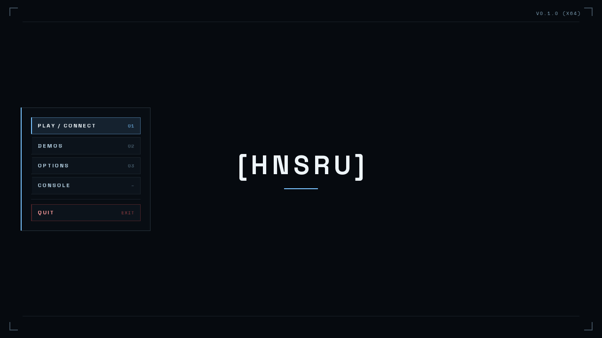
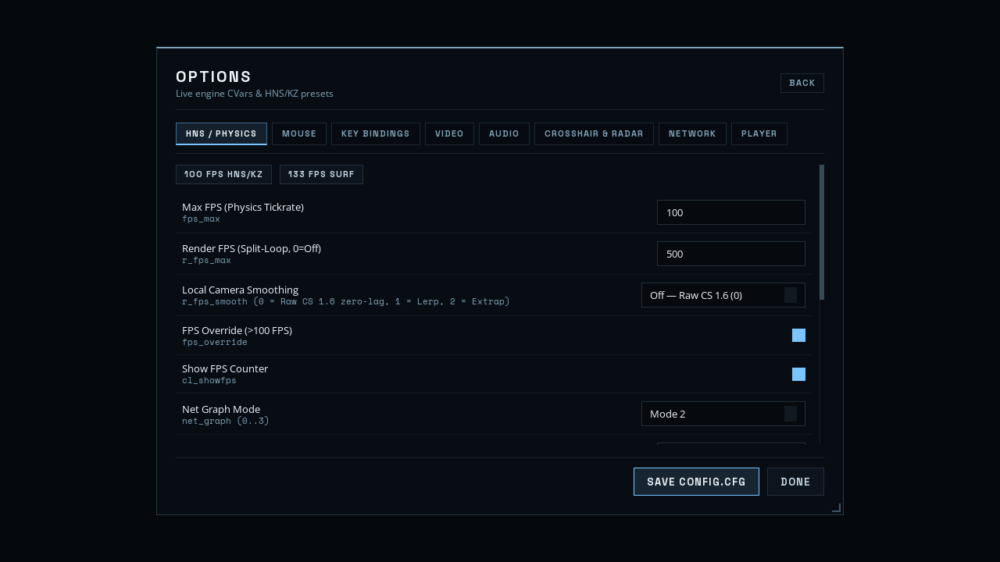
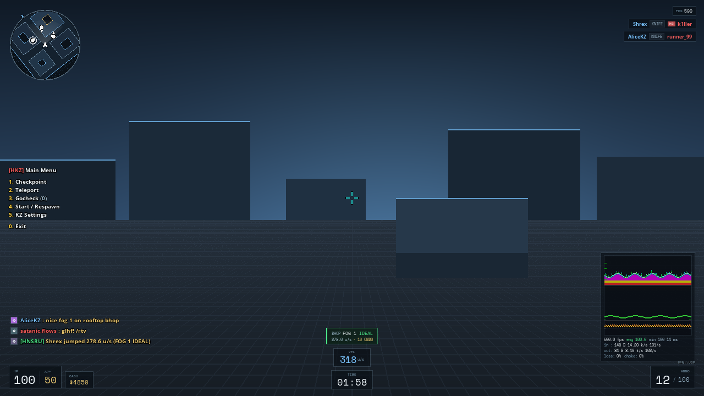
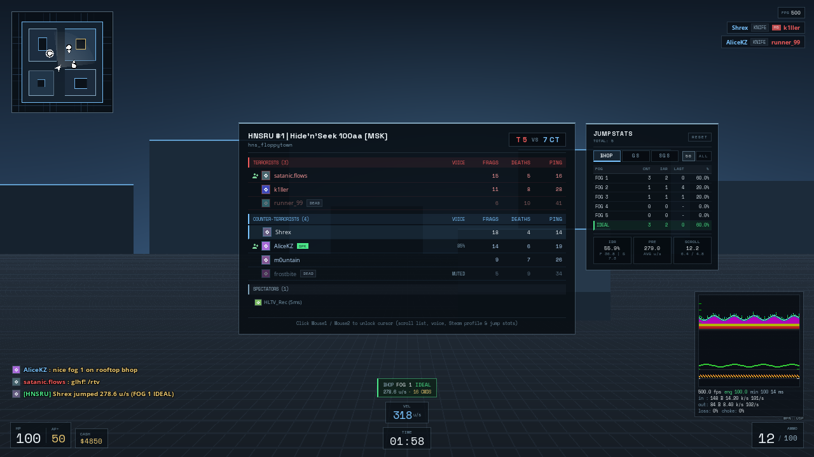
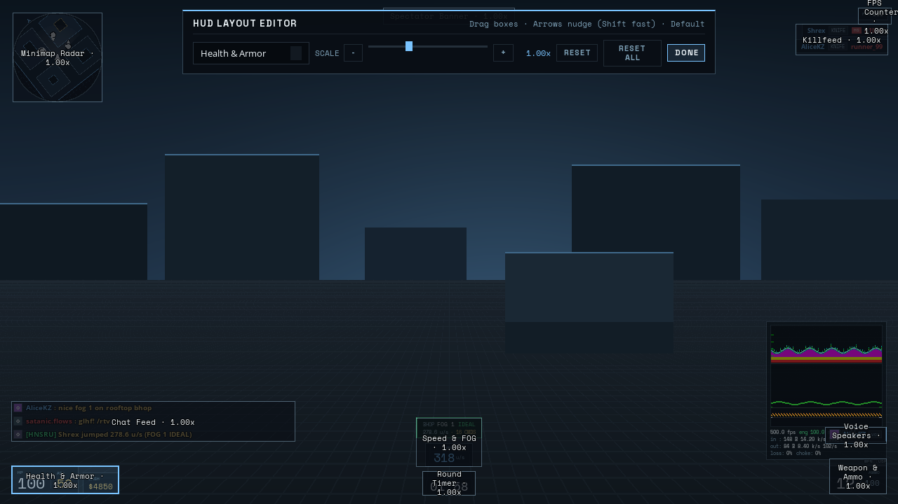
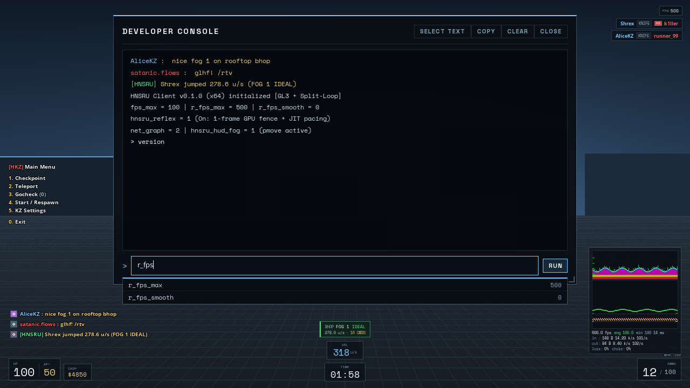
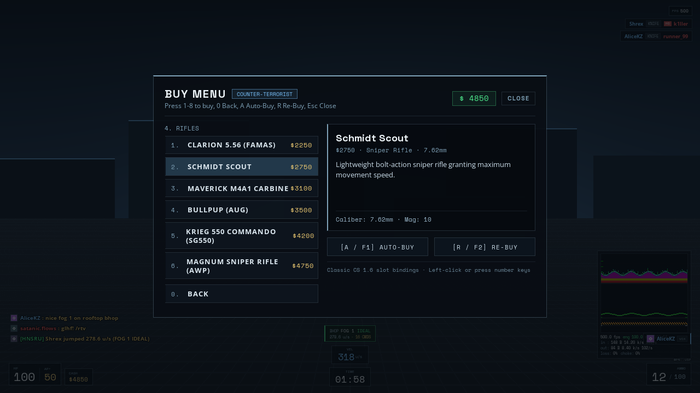
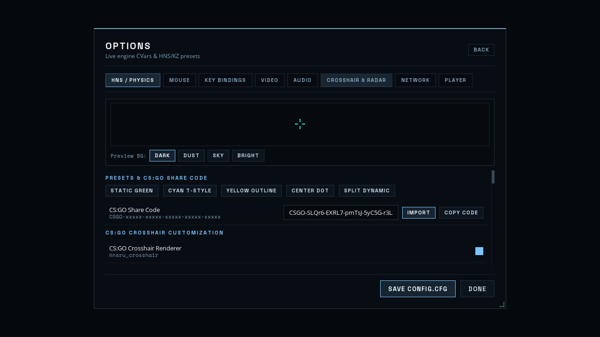
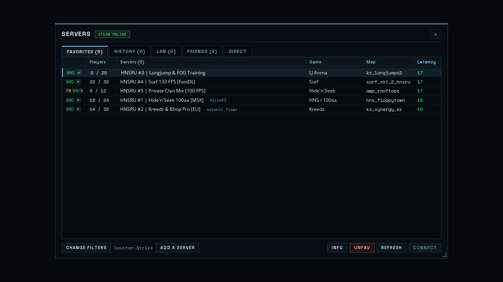

[English](ANNOUNCEMENT.md) | **Русский**

# HNSRU Client v0.1.0 (x64) — Новый клиент CS 1.6 для HNS, KZ и Surf

**HNSRU Client** — это полностью переработанный 64-битный клиент Counter-Strike 1.6, созданный специально для комьюнити **Hide'n'Seek, Kreedz (KZ) и Surf**.

Клиент собран в один файл `hnsru.exe` (без набора устаревших интерфейсных и браузерных библиотек), напрямую работает с запущенным Steam, использует современный рендерер **OpenGL 3.3**, разделённый цикл физики/рендера **500+ FPS** и единый стеклянный интерфейс **Tactical Glass Visor**.

---

## Содержание

1. [Плавные 500+ FPS при честной физике 100/133 FPS (Split-Loop)](#1-плавные-500-fps-при-честной-физике-100133-fps-split-loop)
2. [Минимальная задержка ввода: Reflex-Lite (`hnsru_reflex`)](#2-минимальная-задержка-ввода-reflex-lite-hnsru_reflex)
3. [Новый OpenGL 3.3 рендерер и настройки экрана без перезапуска](#3-новый-opengl-33-рендерер-и-настройки-экрана-без-перезапуска)
4. [Инструменты для HNS / KZ / Surf: FOG, ShowPre и статистика прыжков](#4-инструменты-для-hns--kz--surf-fog-showpre-и-статистика-прыжков)
5. [Единый интерфейс Tactical Glass Visor и редактор HUD](#5-единый-интерфейс-tactical-glass-visor-и-редактор-hud)
6. [Прицел уровня CS:GO и живая миникарта-радар](#6-прицел-уровня-csgo-и-живая-миникарта-радар)
7. [Steam Server Browser, аватарки, друзья и персональный мут](#7-steam-server-browser-аватарки-друзья-и-персональный-мут)
8. [Чистый звук 48 kHz, микшер по категориям и быстрая загрузка карт (FastDL)](#8-чистый-звук-48-khz-микшер-по-категориям-и-быстрая-загрузка-карт-fastdl)
9. [Демки (`.dem`), безопасный HTML MOTD и совместимость с серверами](#9-демки-dem-безопасный-html-motd-и-совместимость-с-серверами)
10. [Честная игра (Fair Play) и архитектурные решения](#10-честная-игра-fair-play-и-архитектурные-решения)
11. [Быстрая шпаргалка команд для игроков](#11-быстрая-шпаргалка-команд-для-игроков)

---

## 1. Плавные 500+ FPS при честной физике 100/133 FPS (Split-Loop)

В классическом CS 1.6 частота картинки на экране жёстко привязана к частоте физики: хочешь плавную картинку под монитор 144/240/360 Hz — повышаешь `fps_max`, и сразу ломается физика прыжков, замедляется падение, серф начинает «липнуть», а античиты кикают за высокий FPS.

В **HNSRU Client** физика и отрисовка кадров **разделены на уровне движка (Split-Loop)**:

| Параметр | Что это простыми словами | Рекомендация для игроков |
| :--- | :--- | :--- |
| **`fps_max`** | **Честный тикрейт физики и движения** (то, как часто считаются прыжки, стрейфы, скорость и пакеты на сервер). | **`100`** для HNS/KZ/Public, **`133`** для Surf. Античиты видят именно ваш физический FPS (`100` или `133`). |
| **`fps_override`** | Разрешает поднимать физический `fps_max` выше 100 (например, до 133 для серфа). | Включается автоматически при выборе пресета `133 FPS Surf`. |
| **`r_fps_max`** | **Визуальный FPS (частота отрисовки кадров)** на ваш монитор. Не влияет на физику, высоту прыжка и скорость! | **`500`** (по умолчанию) или под герцовку вашего монитора (`240`, `360`, `500`). `0` — отключить разделение. |
| **`r_fps_smooth`** | Режим сглаживания камеры при высоком `r_fps_max`: • **`0` — Raw CS 1.6**: нулевая задержка камеры, мышь и движение отзываются мгновенно, как в оригинальной CS 1.6; • **`1` — Interpolated**: сверхплавное движение на 240–500 Hz; • **`2` — Extrapolated**: упреждающее сглаживание без ощущения вязкости. | **`0`** для жёсткого HNS/KZ и стрейфов без задержки, **`1`** для Surf или комфортного наблюдения. |
| **`cl_spec_interp`** | Плавность движения других игроков и в режиме спектатора (в секундах). | **`0.05`** (по умолчанию) — идеально плавные модели в полёте даже на 500 FPS. |

### Новый `net_graph` с контролем физического FPS
Классический `net_graph` часто ломался на новых видеодрайверах или накладывался на HUD. Мы полностью переписали его (`net_graph 1 / 2 / 3`) и добавили прямо в строку метрик **физический FPS движка**:
- Белое число слева (`500.0 fps`) — ваш **визуальный FPS** (плавность картинки).
- Зелёный показатель **`eng 100.0`** и **`min 99.8`** — реальный **физический FPS движка** и его минимум за последнее время. Если видите, что `eng` зелёный — физика идёт идеально ровно (`100` Hz), никаких микрофризов или просадок при прыжках нет; если желтеет/краснеет — значит конкретно физика просела и пора снизить нагрузку или проверить фоновые программы.

---

## 2. Минимальная задержка ввода: Reflex-Lite (`hnsru_reflex`)

Многие игроки замечали странный эффект на мощных ПК или с включённой вертикальной синхронизацией: высокий FPS есть, а мышь ощущается чуть «ватной» или «резиновой». Причина — **очередь кадров на видеокарте (Render Queue)**. Обычный движок может подготовить мышь и отправить кадр в драйвер заранее, пока видеокарта ещё дорисовывает 2–3 предыдущих кадра. Из-за этого между движением руки и реакцией на экране появляется лишняя задержка (input lag).

**Reflex-Lite (`hnsru_reflex`)** устраняет эту очередь и синхронизирует момент считывания мыши:

- **`hnsru_reflex 0` (Off)** — классическое поведение движка без синхронизации очереди GPU.
- **`hnsru_reflex 1` (On — рекомендуется по умолчанию)** — оптимальный баланс стабильности и минимальной задержки:
  1. **Убирает лишнюю очередь кадров на видеокарте**: кадры не копятся в буфере перед выводом на экран.
  2. **Точный момент считывания мыши**: движок опрашивает мышь максимально близко к началу отрисовки нового кадра, вместо того чтобы делать это с лишним ожиданием.
  3. **При включённом VSync (`gl_vsync 1`)**: синхронизируется с обновлением экрана напрямую, убирая привычный «кисельный» инпут-лаг вертикальной синхронизации.
- **`hnsru_reflex 2` (Boost)** — максимально отзывчивый режим для соревновательного HNS/KZ и мониторов 240+ Hz: сокращает все буферные допуски перед кадром, отдавая приоритет абсолютно минимальному отклику мыши.

> **Что чувствует игрок на практике:** при стрейфах и фликах прицел «прилипает» к руке заметно точнее, убирается микроскопическое «плавание» на 100 FPS и при VSync, а фреймтайм под `r_fps_max` остаётся максимально ровным без рывков.

---

## 3. Новый OpenGL 3.3 рендерер и графика без перезапуска

- **Современный GL3-рендерер (`r_gl3 1`)**: адаптированный под x64 рендерер на OpenGL 3.3 с оптимизацией геометрии — стабильный высокий FPS, быстрая отрисовка карт и HUD без устаревших ограничений.
- **Смена разрешения и режима окна на лету (`Options -> Video`)**: переключение между Fullscreen и Windowed, выбор соотношения сторон (`4:3`, `16:10`, `16:9`), включение Stretch Aspect (растянуть `4:3` на весь экран или оставить чёрные полосы по бокам) — **без перезахода в игру и без потери подключения к серверу**.
- **Правильный широкоформатный обзор (`gl_widescreen_yfov`)**: Hor+ FOV для `16:9` / `16:10` мониторов, чтобы картинка по краям не обрезалась (или выключите для классического `90°` обзора CS 1.6).
- **Быстрые пресеты 1 клик**: кнопки `100 FPS HNS/KZ`, `133 FPS Surf`, `HNSRU Optimal Network (100k / 101 / 0.01)`.

---

## 4. Инструменты для HNS / KZ / Surf: FOG, ShowPre и статистика прыжков

Вместо неточного плоского LJStats мы встроили **точную телеметрию прыжков прямо в клиент** — по тем же правилам расчёта отрыва и приземления, которые используют серверы:

- **Живое уведомление о прыжке (`hnsru_hud_fog 1`)**: после отталкивания над спидометром аккуратно всплывает плашка:
  - Тип прыжка (**`BHOP`**, **`GS`**, **`SGS`**), точный **`FOG`** (количество кадров на земле перед прыжком), статус **`IDEAL`** / **`FAIL`**, реальная скорость отталкивания (`u/s`) и количество скроллов (**`CMDS`**).
  - Карточка мягко затухает и исчезает сама (через ~2.2 сек), чтобы не мешать обзору во время рана.
  - Работает **даже при отключённом новом HUD (`hnsru_hud 0`)** — если вам привычнее классические спрайты ХП/брони, FOG всё равно будет работать!
- **Чистый спидометр (`hnsru_hud_speed 1`)**: крупная, идеально ровная цифра скорости `u/s` с цветовой градацией по скорости (белый → золотой → зелёный → ледяной синий), ничего не скачет и не сдвигается по высоте.

- **Вкладка Jump Stats прямо внутри `TAB` (`+showscores`)**: никаких лишних биндов — откройте таблицу счёта и нажмите **Mouse1 / Mouse2**, чтобы переключить вкладки **`BHOP`**, **`GS`**, **`SGS`**, диапазон (**`Last 50`** / **`ALL`**) или нажать **`RESET`** (также доступна консольная команда `hnsru_jumpstats_reset`):
  - Разбивка по `FOG 1 .. FOG 5` и `IDEAL` (`CNT`, `IAR`, `LAST`, `%`);
  - **`IDR`** (процент идеальных прыжков + разбивка на ранний `Fast` / поздний `Slow` скролл);
  - **`AVG PRE`** (средняя скорость входа в прыжок) и **`AVG SCROLLS`** (среднее количество тиков скролла до/после отрыва).

---

## 5. Единый интерфейс Tactical Glass Visor и редактор HUD

Весь клиент — от стартового экрана до закупки и таблицы счёта — оформлен в едином стиле **Tactical Glass Visor**: тёмно-сланцевое полупрозрачное стекло, тонкие грани, ледяной синий акцент и идеальная читаемость как на тёмных, так и на ярких картах.

### Интерактивный редактор HUD (`hnsru_hud_edit` или кнопка в меню паузы)
Каждый элемент интерфейса можно **перетаскивать мышкой, подгонять стрелками** (`Shift` для быстрого сдвига) и **масштабировать векторно от `0.50x` до `2.00x`** без потери чёткости шрифтов:
- Health & Armor, Weapon & Ammo, Round Timer, Speed & FOG, Chat Feed, Minimap Radar, Voice Speakers, Killfeed, FPS Counter, Spectator Banner, Scoreboard.
- Расположение сохраняется автоматически в `cstrike/hnsru_hud_layout.cfg`.

### Остальные обновлённые элементы HUD и меню
- **Поддержка классического режима (`hnsru_hud 0`)**: мгновенно возвращает классические зелёные/золотые спрайты CS 1.6, но при этом **оставляет чёткий UTF-8 чат, AMXX-меню, HUD/DHUD-сообщения серверов и FOG-нотификацию**.
- **Новый чат с кириллицей и аватарками**: полная поддержка русского языка (UTF-8), командного/общего чата (`say` / `say_team`) и скроллируемой истории сообщений.
- **AMXX ShowMenu и серверные HUD/DHUD-сообщения**: плагины серверов (меню чекпоинтов, таймеры, рекорды карт) рендерятся векторным шрифтом без мерцания, с корректным выравниванием правых колонок (`\R`) и цветами (`\r`, `\y`, `\w`, `\d`).
- **Консоль разработчика**: плавно выезжающее полупрозрачное окно с историей команд, живым списком автодополнения по мере ввода, выделением строк и копированием лога в буфер обмена в 1 клик.

- **Меню закупки (`Buy Menu`) и выбора команды**: классические бинды CS 1.6 (`1–8`, `0` назад, `A / F1` Auto-Buy, `R / F2` Re-Buy) в современном интерфейсе с карточкой характеристик оружия и подсветкой доступного бюджета.

- **Редактор биндов (`Options -> Key Bindings`)**: назначение до 2 клавиш на действие (поддерживается клавиатура, мышь и **колесо прокрутки** для прыжков/приседаний), плюс строка быстрого бинда любой пользовательской команды (`say /cp`, `+hook` и др.).

---

## 6. Прицел уровня CS:GO и живая миникарта-радар

### Прицел CS:GO (`hnsru_crosshair 1`)
Больше не нужно мириться с ограниченным прицелом 1.6 — настраивайте прицел точно как в CS:GO в разделе **`Options -> Crosshair & Radar`**:
- Стили `0..5` (включая классическую статику `style 4`, динамику `style 2/3` и отдачу 1.6 `style 5`);
- Длина, толщина, зазор (в том числе отрицательный), центральная точка, T-стиль (без верхней риски), чёрная обводка, альфа-прозрачность и любой RGB-цвет;
- Живое превью с переключением фона (`Dark` / `Dust` / `Sky` / `Bright`) и готовые пресеты;
- **Полный импорт и экспорт Share Code (`CSGO-xxxxx-xxxxx-xxxxx-xxxxx-xxxxx`)** — просто вставьте код прицела из CS:GO/CS2.

### Живой BSP-радар в стиле CS:GO (`hnsru_radar 1`)
На большинстве HNS, KZ и Surf карт вообще нет файлов `overviews/*.bmp`, поэтому старый радар либо пустой, либо бесполезен.
Мы встроили **настоящий ортографический рендерер карты**:
- Читает геометрию самой `.bsp` карты и строит чёткую тактическую схему **на любой карте автоматически**;
- Умное отсечение потолков (`hnsru_radar_zcut`), чтобы на многоэтажных HNS-картах было видно текущий этаж и соседние проходы;
- Два визуальных стиля (`hnsru_radar_style`: `0` — текстурированный, `1` — чистый чертёж/blueprint);
- Конус обзора, отметки союзников и врагов (в спектаторе), индикаторы высоты **`▲` / `▼`** (сразу видно, выше или ниже вас игрок), подсвечивание говорящих игроков и бомбы;
- **Квадратная обзорная карта при удержании `TAB`** (`cl_radar_square_with_scoreboard 1`) и полная линейка знакомых настроек (`cl_hud_radar_scale`, `cl_radar_scale`, `cl_radar_rotate`, `cl_radar_always_centered`).

---

## 7. Steam Server Browser, аватарки, друзья и персональный мут

- **Встроенный Steam-браузер серверов**:
  - Вкладки **`Favorites`**, **`History`**, **`LAN`**, **`Friends`** (сразу видно, на каком сервере сейчас играют ваши друзья из Steam) и **`Direct`** (быстрое подключение по `ip:port` с паролем и кнопкой Reconnect);
  - Живой пинг, сортировка по любому столбцу, бейджи **`VAC`**, **`PW`**, **`*`**, коллапсируемая панель фильтров и модальное окно **`Game Info`** со списком игроков и временем на сервере, плюс контекстное меню по правому клику.
- **Steam-аватарки**: отображаются в `TAB`, чате и панели говорящих игроков (`scoreboard_showavatars 1`).
- **Удобный голосовой контроль в `TAB`**: откройте курсор по `Mouse1 / Mouse2` в таблице счёта и у каждого игрока можно нажать **`M` (Mute)** или выставить **индивидуальную громкость (`0%..200%`)** — клиент запомнит настройку по его SteamID! По клику можно открыть профиль игрока прямо в Steam Overlay.

---

## 8. Чистый звук 48 kHz, микшер по категориям и быстрая загрузка карт (FastDL)

- **Апгрейд звукового движка до 48 kHz**: чистая передача и ресемплинг голосового чата Steam / Opus (`voice_hq 1`) без старого хрипа и искажений + защита от клиппинга.
- **Раздельный микшер громкости по категориям** (находится в `Options -> Audio`):
  - `hnsru_vol_steps` — **шаги** (можно сделать громче на 100%, чтобы лучше слышать противников);
  - `hnsru_vol_weapons` — выстрелы и удары ножом;
  - `hnsru_vol_ambient` — фоновый шум карты (можно приглушить почти в ноль);
  - `hnsru_vol_shells` — звон гильз;
  - `hnsru_vol_vox` — радио и озвучка (`Fire in the hole!` и т.д.);
  - `hnsru_vol_world` — двери, кнопки и звуки окружения.
- **Многопоточный FastDL (`hnsru_fastdl 1`)**: быстрая параллельная докачка карт, моделей и звуков с HTTP/HTTPS серверов (до 15 потоков через `hnsru_fastdl_threads`).

---

## 9. Демки (`.dem`), безопасный HTML MOTD и совместимость с серверами

- **Полная совместимость с 32-битными демками CS 1.6 и HL25**: можно смотреть любые старые `.dem` записи на 64-битном клиенте; работает браузер локальных демок и компактная панель управления воспроизведением по **`F2`** (пауза, перемотка, скорость `0.25x .. 4x`, пошаговый кадр).
- **Изолированный HTML MOTD**:
  - Серверные сайты/статистика/топ-15 открываются в современном встроенном окне с авто-приглушением звука (`hnsru_motd_mute 1`) и опцией `cl_disablehtmlmotd 1` (режим чистого текста);
  - Безопасный режим: разрешены только обычные веб-страницы (`http://` и `https://`), блокируются попытки открытия локальных файлов и посторонние переадресации.
- **Улучшенная сетевая совместимость со старыми серверами**:
  - Убраны ложные кики с причиной `Fake client. Connection was in idle state.` при подключении на классические серверы;
  - Сохранена полная совместимость с классическими серверными проверками файлов и настроек клиента.

---

## 10. Честная игра (Fair Play) и архитектурные решения

При разработке клиента мы осознанно приняли несколько важных решений для защиты комьюнити и честной игры:

### Почему в клиенте нет создания локальной игры (Listen Server / Single-Player)?
Это принципиальное решение ради **целостности KZ/HNS/Surf-рекордов (WR)**:
- В HNSRU Client встроены удобные тренировочные инструменты прямо на экране (индикатор **FOG**, отображение скроллов **CMDS**, спидометр, прицел и **Split-Loop FPS**).
- Во многих сторонних KZ-комьюнити и при подаче мировых рекордов **демки (`.dem`), записанные на модифицированных клиентах, могут не принимать** или признавать нелегитимными.
- Чтобы игроки **ни случайно, ни намеренно не записали локальный WR на этом клиенте** и потом не потеряли зачёт времени при проверке, кнопка запуска локального одиночного сервера намеренно убрана из меню.
- **HNSRU Client создан как онлайн-клиент для серверов** (при этом вкладка **`LAN`** в браузере серверов полностью сохранена — к запущенному отдельно выделенному серверу в локальной сети можно спокойно подключаться).

### Другие ключевые решения
- **Только лицензионный Steam**: клиент напрямую подключается к вашему запущенному клиенту Steam (официальная авторизация без лишних прослоек) — аватарки, список друзей и голосовой чат работают штатно.
- **Единый исполняемый файл `hnsru.exe`**: весь клиент собран в одном 64-битном файле — меньше проблем с несовместимыми или устаревшими библиотеками рядом с игрой.
- **Встроенное автообновление и два канала**:
  - По умолчанию клиент обновляется из стабильного канала (`release`), а с параметром запуска `-beta` — из тестового канала (`beta`);
  - Если обновление вышло пока вы на сервере, клиент не перезапускается во время игры и показывает аккуратную плашку `CLIENT OUTDATED` сверху экрана;
  - После обновления на главном экране открывается список изменений, который также всегда можно вызвать консольной командой `hnsru_changelog`.

---

## 11. Быстрая шпаргалка команд для игроков

| Команда / CVar | По умолчанию | Описание |
| :--- | :--- | :--- |
| `fps_max` | `100` | Частота физики и движения (`100` HNS/KZ, `133` Surf) |
| `r_fps_max` | `500` | Частота отрисовки кадров на монитор (`0` — выключить Split-Loop) |
| `r_fps_smooth` | `0` | Сглаживание камеры (`0` Raw 1.6 / `1` Lerp / `2` Extrap) |
| `cl_spec_interp` | `0.05` | Сглаживание моделей игроков и спектатора |
| `hnsru_reflex` | `1` | Reflex-Lite: уменьшение задержки ввода (`0` Выкл / `1` Вкл / `2` Boost) |
| `net_graph` | `0` | График сети и контроль физического FPS движка (`0..3`) |
| `r_gl3` | `1` | Современный OpenGL 3.3 рендерер |
| `hnsru_hud` | `1` | Новый HUD (`1`) или классический спрайтовый HUD CS 1.6 (`0`) |
| `hnsru_hud_edit` | *(команда)* | Открыть интерактивный редактор расположения и размера HUD |
| `hnsru_hud_fog` | `1` | Уведомление FOG / ShowPre при прыжке (работает даже при `hnsru_hud 0`) |
| `hnsru_hud_speed` | `1` | Спидометр под прицелом |
| `hnsru_jumpstats_reset` | *(команда)* | Сбросить статистику BHOP / GS / SGS в `TAB` |
| `hnsru_crosshair` | `1` | Прицел уровня CS:GO + импорт/экспорт Share Code |
| `hnsru_radar` | `1` | Живая ортографическая миникарта по геометрии `.bsp` |
| `hnsru_radar_style` | `0` | Стиль миникарты (`0` текстурированный / `1` чертёж) |
| `hnsru_vol_steps` | `1.0` | Отдельная громкость шагов (`hnsru_vol_ambient`, `hnsru_vol_weapons` и др.) |
| `hnsru_fastdl` | `1` | Многопоточная быстрая загрузка файлов (`hnsru_fastdl_threads`) |
| `hnsru_motd_mute` | `1` | Отключить звук в HTML MOTD окнах (`cl_disablehtmlmotd 1` — только текст) |
| `hnsru_changelog` | *(команда)* | Открыть список изменений последнего обновления |
